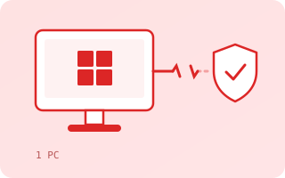
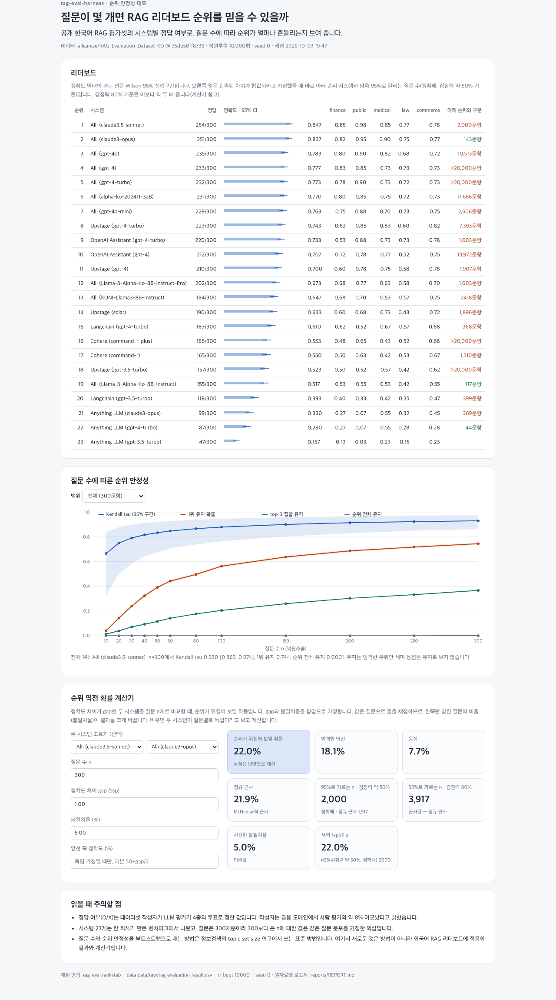
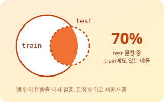
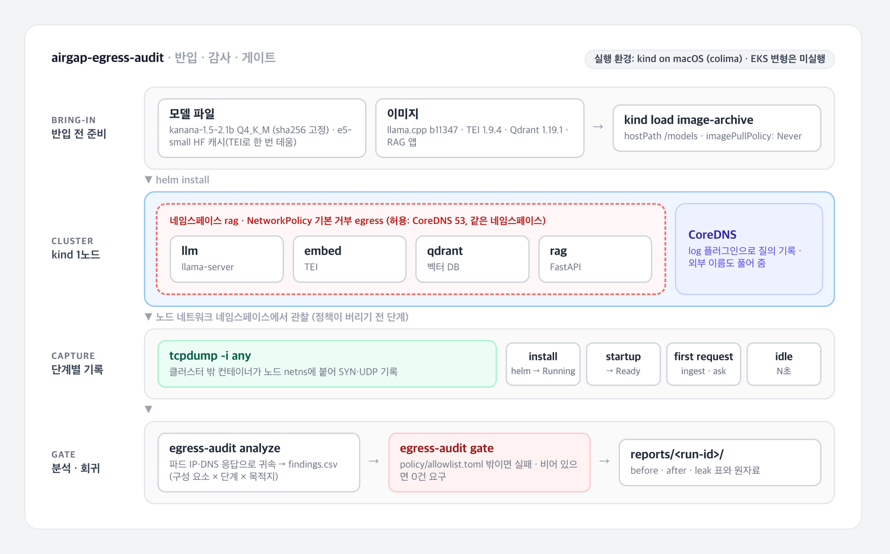

### 데이터가 들어와서 쓰이기까지의 길을 만들고, 그 길이 어디서 끊기는지 먼저 찾는 엔지니어입니다.

> [!NOTE]
> 전체 프로젝트의 배경·접근·결과와 기술 노트는 [**포트폴리오 사이트**](https://parksungyun0411.github.io)에 정리되어 있습니다.

## 🚀 대표 프로젝트

실무에서 맡은 일과, 실무에서 생긴 질문을 공개 데이터로 끝까지 확인한 개인 프로젝트입니다. 설계 판단과 검증 과정은 각 저장소와 사이트의 프로젝트 상세에 있습니다.

<table>
  <tr>
    <td width="50%" valign="top">
      
      <h3><a href="https://parksungyun0411.github.io/projects/driver-risk-platform/">공공기관 납품 교통사고 위험 예측 AI 플랫폼</a></h3>
      운수종사자의 검사 결과와 사고 이력으로 개인별 사고 위험도를 산출하고 SHAP으로 요인을 설명하는 납품 플랫폼입니다. 2026년 9월에 인수해 운영과 유지보수를 맡고 있습니다. 발주기관의 재요청을 받고 원인을 따라가 보니 화면마다 '최신 검사'를 고르는 범위가 달라 목록·대시보드·다운로드가 개별 진단과 다른 검사를 보이고 있었습니다. 대표 검사를 고르는 기준을 한 곳으로 모으고, 380명·5,000명 규모로 따로 계산한 결과와 대조한 뒤 v9.4.0 배포본을 만들었습니다.  
      <a href="https://parksungyun0411.github.io/projects/driver-risk-platform/"><b>프로젝트 상세</b></a> · 발주기관 보안 조항에 따라 코드 비공개 
      FastAPI · LightGBM · SHAP · React · eGovFrame · Nginx
    </td>
    <td width="50%" valign="top">
      
      <h3><a href="https://github.com/parksungyun0411/rag-eval-harness">RAG 리더보드 순위 안정성</a></h3>
      공개 한국어 RAG 리더보드의 순위가 질문 수에 따라 얼마나 흔들리는지 부트스트랩 10,000회로 재고, 시뮬레이션을 정확해로 검증했습니다. 300문항으로는 1위와 2위를 가를 수 없다는 결과를 얻었고, 역전 확률·필요 질문 수를 계산하는 계산기를 만들었습니다.  
      <a href="https://github.com/parksungyun0411/rag-eval-harness"><b>저장소</b></a> · <a href="https://parksungyun0411.github.io/projects/rag-eval-harness/">프로젝트 상세</a> · <a href="https://parksungyun0411.github.io/notes/rag-leaderboard-rank-stability/">기술 노트</a> 
      Python · NumPy · SciPy · FastAPI · pytest
    </td>
  </tr>
  <tr>
    <td width="50%" valign="top">
      
      <h3><a href="https://github.com/parksungyun0411/jeju-emotion-analysis">제주어 다중감정분류 · 결과 재검증</a></h3>
      4인 팀 졸업 프로젝트에서 기술 파트를 맡아 감정 라벨이 없는 제주어 문장에 GPT-4o 라벨링을 자동화하고 KR-BERT·KoELECTRA 인코더 앙상블을 만들었습니다. 졸업 후 결과를 다시 검증해 test 문장의 70%가 train에도 들어 있는 분할 누수와 코드 속 감정 이름 두 개가 뒤바뀐 것을 찾았습니다. 문장 단위로 다시 나눈 분할에서 재평가하니 앙상블 macro-F1이 0.84에서 0.52로 내려갔습니다.  
      <a href="https://github.com/parksungyun0411/jeju-emotion-analysis"><b>저장소</b></a> · <a href="https://parksungyun0411.github.io/notes/jeju-emotion-stepwise/">기술 노트</a> 
      PyTorch · HuggingFace · KR-BERT · KoELECTRA
    </td>
    <td width="50%" valign="top">
      
      <h3><a href="https://github.com/parksungyun0411/airgap-egress-audit">폐쇄망 반입 후 외부 호출 감사</a></h3>
      egress를 막은 쿠버네티스 네임스페이스에 한국어 소형 LLM과 RAG 스택을 설치하고, 설치·기동·첫 요청·유휴 단계의 외부 호출 시도를 패킷으로 기록했습니다. 허용 목록 밖 호출이 있으면 실패하는 회귀 게이트를 만들어, 완화 전 6개 항목이 완화 설정 뒤 0건이 되는 것을 확인했습니다(push CI는 커밋한 감사 기록을 다시 검사).  
      <a href="https://github.com/parksungyun0411/airgap-egress-audit"><b>저장소</b></a> · <a href="https://parksungyun0411.github.io/projects/airgap-egress-audit/">프로젝트 상세</a> 
      Kubernetes (kind) · NetworkPolicy · tcpdump · llama.cpp · Qdrant
    </td>
  </tr>
</table>

나머지 프로젝트는 [포트폴리오 사이트](https://parksungyun0411.github.io/projects/)에서 볼 수 있습니다.

## 💼 경력

### 데이콘

**운영·개발 파트 · 서비스 기획 · 풀스택 개발 · QA** · `2026.04 – 현재`

AI 해커톤 플랫폼의 평가 기능을 기획서부터 구현까지 맡아 운영에 반영하고, 인수한 공공기관 납품 플랫폼 운영과 플랫폼 전반의 주간 QA, 경진대회 현장 운영 보조를 함께 합니다.

#### ▎개발

| 프로젝트 | 기간 | 발주·주관 | 내용 |
| --- | --- | --- | --- |
| **교통사고 위험 예측 AI 플랫폼 개발·배포** | 2026.09&nbsp;–&nbsp;현재 | NIA 정책 수립 지원 데이터 분석 사업 (공공기관 주관) | 인수 후 운영·유지보수. 인수인계 패키지를 분석해 코드 구조를 파악하고 보류 목록 71건의 우선순위를 정함. 발주기관 재요청에 대응해 화면마다 달랐던 대표 검사 선정을 한 곳으로 모으고 380명·5,000명 규모 독립 계산과 대조한 뒤 v9.4.0 배포본 빌드. 운영하며 다루는 구조: 경진대회 모델 앙상블, 엑셀 전 시트 적재, 망분리 PC용 오프라인 설치·롤백 |
| **해커톤 평가 설정 재설계** | 2026.04 | 자사 플랫폼 | 기존 제출·평가 단계 구조 위에서 평가일정·평가설정·공개설정을 나누는 기획서를 먼저 쓰고 그 구조대로 구현(동료 리뷰 수정을 거쳐 머지). 분리된 단계 구조에서 설정·가중치를 평가 단계에서 읽도록 고쳐 운영에 반영 |
| **ELO 대중평가 설계·감사·신뢰도 검증** | 2026.04&nbsp;–&nbsp;2026.09 | 자사 플랫폼 | 채널별 정규화 룰 설계(구현은 동료), 결함 감사와 수정, 실제 투표 처리 코드와 대조한 합성 데이터 시뮬레이션으로 순위를 믿을 수 있는 비교 횟수 산출(제출물당 평균 20회), 호혜 게이트·아레나 재설계 구현 후 운영 반영 |

#### ▎QA · 운영

플랫폼 주간 QA(약 14주 동안 QA 티켓 86건)와 QA 준비 자동화, 대학 연합 경진대회 본선 현장 운영 보조, 공공기관 경진대회 온라인 설명회 발표를 맡습니다.

### 자빅스

**클라우드·엔터프라이즈 서비스 운영팀 (인턴)** · `2025.05 – 2025.08`

| 프로젝트 | 내용 |
| --- | --- |
| **AWS 고객 요청 관리 · 과금 산정** | 재판매 고객사의 AWS 요청 사항 정리, 사용량 분석, 과금 산정 후 어드민 전달 |
| **공공 메신저 기능 기획** | 사용자 약 15만 명 규모 공공 메신저의 조직도 기반 사용자 조회·대화방 기능 기획 참여 |

## 🛠 기술 스택

| 영역 | 기술 |
| --- | --- |
| LLM · Agent |     |
| ML · 데이터 |       |
| 서빙 · 인프라 |         |
| 웹 · 테스트 |     |

## 🧪 개인 프로젝트 (2026.10 · 공개 데이터)

데이콘에서 일하며 생긴 질문과, 지원하는 직무 공고가 요구하는 기술(RAG, 평가, 에이전트·MCP, 파인튜닝·서빙, 쿠버네티스, 폐쇄망)마다 하나씩 주제를 골랐습니다. 회사의 코드와 데이터는 쓰지 않았습니다. 측정 수치는 각 저장소 `reports/`의 리포트에서, 설계 수치(설정 수·시나리오 수 등)는 각 저장소 README와 코드에서 옮겼습니다. 코드와 테스트는 있지만 아직 실행하지 않은 저장소는 "진행 중"으로 표시하고 결과 칸에 "측정 전"이라고 적었습니다.

| 저장소 | 질문 | 핵심 수치 |
| --- | --- | --- |
| [rag-eval-harness](https://github.com/parksungyun0411/rag-eval-harness) | 리더보드 순위를 몇 문항부터 믿을 수 있는가 | 시스템 23개 × 질문 300개 · 1위 유지 0.744 · 1–2위 McNemar p 0.6072 |
| [airgap-egress-audit](https://github.com/parksungyun0411/airgap-egress-audit) | 폐쇄망에 반입한 LLM·RAG 스택이 밖으로 무엇을 보내려 하는가 | 게이트 실패 6개 항목 → 0건 (로컬 kind 클러스터) |
| [k-mcp-qa](https://github.com/parksungyun0411/k-mcp-qa) | 공공데이터 MCP 서버 10개를 같은 시험으로 돌리면 무엇이 보이는가 | 서버 10개(+변형 1) · 분류 20종 중 서버 코드에서 9종 관찰 |
| [ko-judge-lora](https://github.com/parksungyun0411/ko-judge-lora) | 사람 점수로 학습한 소형 평가자가 사람과 얼마나 맞는가, 4bit로 줄이면 무엇이 달라지는가 | 측정 완료(T4) · 평가자와 1점 이내 일치 0.874~0.885(평가자 간 0.838) · 31개 모델 순위 τ 0.874 · AWQ는 순위를 지키고 점수를 낮게 줌 |
| [minwon-rag](https://github.com/parksungyun0411/minwon-rag) | 시민이 실제로 쓴 민원 질의에서 dense, 하이브리드, 리랭커 검색은 얼마나 다른가 | 측정 완료(T4) · 민원 16,715건, 실제 질의 150건 · hit@10은 7개 설정 모두 0.827~0.847로 차이가 신뢰구간 안 · 리랭커는 지연만 4.3초(p95) |
| [vendor-check-agent](https://github.com/parksungyun0411/vendor-check-agent) | 공공 API가 실패할 때 에이전트는 고정 파이프라인보다 얼마나 더 복구하고 얼마나 조용히 틀리는가 (진행 중) | 측정 전 · MCP 서버, 실패 주입 프록시 6유형, 복구 전략 4종, LangGraph 에이전트 구현 |
| [jeju-emotion-lora](https://github.com/parksungyun0411/jeju-emotion-lora) | LoRA 소형 LLM이 인코더 앙상블을 문장 단위로 다시 나눈 분할에서 따라잡는가, 양자화 뒤 건당 비용은 얼마인가 | 측정 완료(T4) · 가장 높은 LoRA와 앙상블의 macro-F1 차이(0.530 대 0.519)는 95% 구간이 0을 포함 · 처리량은 앙상블이 8.4배 |
| [cpu-sllm-k8s](https://github.com/parksungyun0411/cpu-sllm-k8s) | GPU 없는 노드에서 CPU limit, 스레드 수, HPA가 소형 LLM 처리량을 얼마나 바꾸는가 | 측정 완료(로컬 kind) · CPU limit 1에서 스레드가 한도를 넘으면 처리량 하락(스레드 1→8: 28.16 → 7.10 tokens/s) · EKS(ECR·eksctl·OIDC) 배포 예정 |

## 📚 학부 프로젝트

| 기간 | 과목 | 프로젝트 |
| --- | :---: | --- |
| 2025.09 – 2025.12 | 졸업 프로젝트 | [제주어 다중감정분류 · 라벨링 자동화부터 누수 재검증까지](https://github.com/parksungyun0411/jeju-emotion-analysis): 4인 팀, 기술 파트(라벨링 자동화·모델 실험) 담당. 졸업 후 재검증으로 분할 누수를 찾아 문장 단위로 재평가(앙상블 macro-F1 0.84 → 0.52) |
| 2024.03 – 2024.05 | 네트워크 프로그래밍 | [라이어 게임 · Java 소켓 멀티플레이어](https://github.com/parksungyun0411/liar-game): 3인 팀, 서버 멀티스레드·게임 로직 담당 |
| 2020 – 2025 | 전 학기 | [학부 과제 코드 모음](https://github.com/parksungyun0411/university-coursework): 자료구조·알고리즘·DB 내부 구조·시스템 프로그래밍·통계전산·회귀·비모수·다변량 |

## 🎓 학력

| 기간 | 학교 | 전공 | 학위 |
| --- | --- | --- | :---: |
| 2020.03 – 2026.02 | 건국대학교 | 스마트ICT융합공학과 (주전공) · 응용통계학과 (복수전공) · 평점 4.10 / 4.5 | 학사 졸업 |

## 📜 자격증 · 어학

| 자격증 | 발급 기관 | 취득일 |
| --- | --- | --- |
| **정보처리기사** | 한국산업인력공단 | 2025.12 |
| **빅데이터분석기사** | 한국데이터산업진흥원 | 2025.12 |
| **데이터분석 준전문가 (ADsP)** | 한국데이터산업진흥원 | 2025.06 |
| **SQL 개발자 (SQLD)** | 한국데이터산업진흥원 | 2024.09 |
| **컴퓨터활용능력 1급** | 대한상공회의소 | 2024.04 |
| **한국사능력검정시험 1급** | 국사편찬위원회 | 2023.08 |

| 시험 | 등급·점수 | 응시일 |
| --- | --- | --- |
| TOEIC Speaking Test | **Intermediate Mid 3 (130점)** | 2026.03 |
| TOEIC | **885점** | 2024.08 |

## 🌱 활동

| 기간 | 기관 | 프로그램 | 역할 |
| --- | --- | --- | :---: |
| 2025.04 – 2025.11 | 정보통신기획평가원 ICT 멘토링 | 한이음 드림업 · 너드수학 AI 수학 학습 플랫폼 (4인 팀) | AI 백엔드 개발 |
| 2019.12 – 2026.04 | 갈매 시그마 수학학원 | 초등 ~ 고3 수학 지도 (군 복무 기간 제외) | 강사 |
